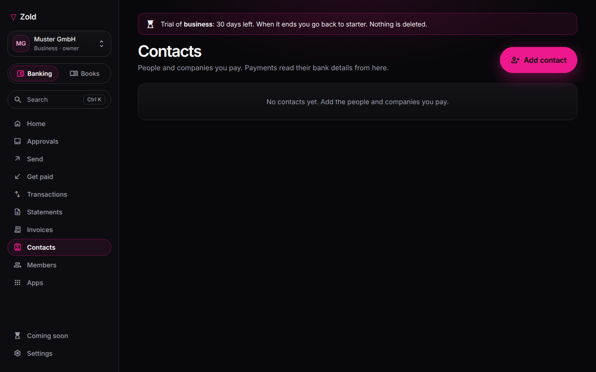

# Address book

Create a contact at Contacts → **New contact**. Add the payee's name, one or more bank accounts (IBAN or local identifier) and wallet addresses, each labelled; add tags and notes. Bank payee names must match the account holder. A wallet's label includes its network.

Viewers can read contacts. Accountants, payers, admins and owners can edit them. Personal accounts use **Saved contacts** in the app.

## If payee details change

Changing a contact's bank account or wallet invalidates every unsent draft that pays it. The draft stops at **Invalid data**; it does not use the new details automatically. Reopen it, confirm the payee and resubmit for review. See [Payments and approvals](payments-and-approvals.md).
