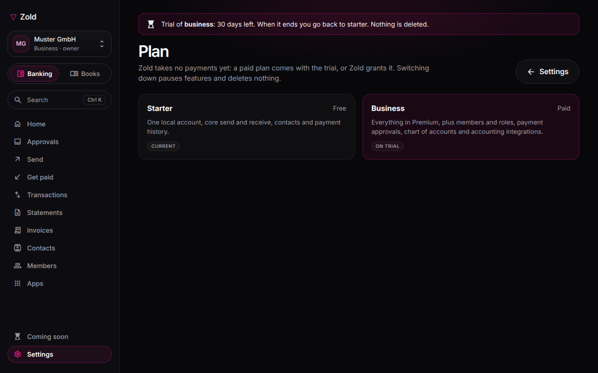

# Organisations and plans

Every Zold account belongs to an **organisation**: a personal space of one or a company with members and finance tools. Open **zoldhq.com/business**. On a phone, main screens are in the bottom tabs; other screens are under **Menu**.

## Personal or business

Personal users can create one personal space with their name and country the first time they open Business. Change its name in the Zold app under Profile. Switch between it and companies from the account switcher. A company login has no personal space; use a personal Zold account for personal money. **Your sign-in and recovery** opens the Zold app's Security screen.

| | Personal | Business |
| --- | --- | --- |
| Members | You | Up to 50, with roles |
| Plans | Starter, Premium | Starter, Business |
| Verification | Your Monerium profile | Company's Monerium profile |
| Invoices | Premium | Business |
| Review, chart of accounts, bulk payments | — | Business |

## Plans and limits

Starter is free. It includes one local account, sending and receiving, contacts, history and receipts; business Starter includes up to three members.

Premium adds up to five local accounts, ten imported wallets, full tagged ledger and historical sync, cost basis and gains, monthly reports, CSV export, reporting currency and invoices.

Business adds up to 20 local accounts, 50 members, 100 imported wallets, 500-row CSV imports, payment review, bulk payments, chart of accounts, automatic rules and accounting integrations.

| Limit | Starter | Premium | Business |
| --- | ---: | ---: | ---: |
| Local accounts | 1 | 5 | 20 |
| Members | 3 | 1 | 50 |
| Imported wallets | 3 | 10 | 100 |
| CSV import rows | — | — | 500 |
| Report history | 3 months | Unlimited | Unlimited |

A limit blocks new items; it never removes existing ones.

## Trial, plan changes and settings

Each organisation gets one **30-day trial** of its paid plan. Choose Settings → Plan → **Start trial**. Your plan stays unchanged; the trial adds access, then returns you to your plan. **Keep it** converts at any time.

Downgrading deletes nothing: accounts, chart, tags, rules, contacts, drafts, invoices and ledger remain. Features pause until you upgrade again.

Partner verification is separate: Monerium checks the euro account; a card issuer checks cards. Settings → **Business profile** shows each status. Settings also holds legal identity, reporting currency/time zone, cost basis and invoicing profile. Organisation country sets invoice rules.
