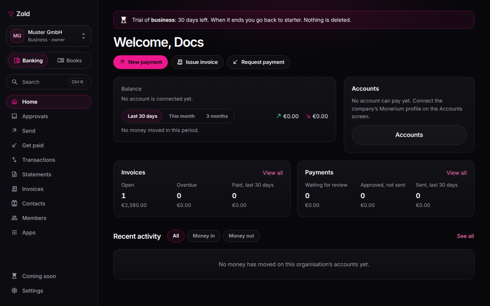

# Organisations

Every Zold account belongs to an **organisation**: a personal space of one, or a company with members and finance tools. Open **zoldhq.com/business**. On a phone, other screens are under **Menu**.

## Personal or business

- **Personal space**: you can create one, with your name and country, the first time you open Business. Change its name under Profile in the Zold app. Switch spaces from the account switcher.
- **Company login**: has no personal space; use a personal Zold account for personal money.
- **Your sign-in and recovery**: opens the Zold app's Security screen.

| | Personal | Business |
| --- | --- | --- |
| Members | You | Up to 50, with roles |
| Verification | Your Monerium profile | Company's Monerium profile |
| Invoices | Yes | Yes |
| Review, chart of accounts, bulk payments | — | Yes |

## Limits

Every feature is free, for personal and business organisations alike.

| Limit | Each organisation |
| --- | ---: |
| Local accounts | 20 |
| Members | 50 |
| Imported wallets | 100 |
| CSV import rows | 500 |
| Report history | Unlimited |

A limit blocks new items; it never removes existing ones.

## Settings

Partner verification is separate: Monerium checks the euro account; a card issuer checks cards. Settings → **Business profile** shows each status. Settings also holds legal identity, reporting currency/time zone, cost basis and invoicing profile. Organisation country sets invoice rules.
