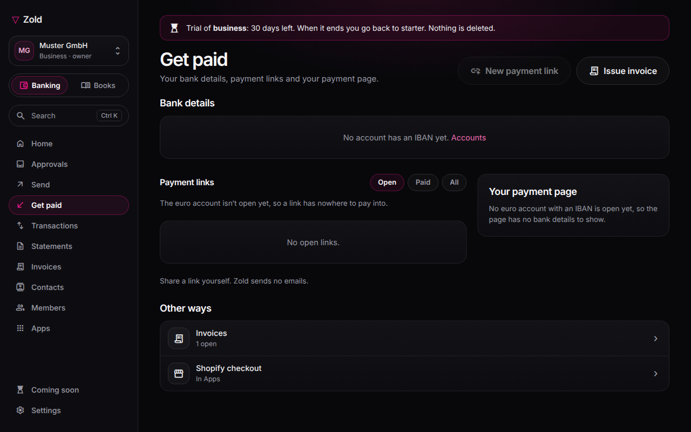

# Payment links

A payment link asks for an amount and explains how to pay. Unlike your [payment page](payment-page.md), it is not an open-ended request.

## Create a link

Profile → **Payment links → New link**.

1. Enter an amount in euros, or leave it blank for the payer to choose.
2. Add **What it is for**.
3. Select payment methods. USDC requires a payment page; bank transfer requires an IBAN.
4. Copy the link or choose **Share**. It stays open for **7 days** unless you set another date; cancel it before anyone pays.

## How the payer pays

| Method | Payer does | Zold matches by |
| --- | --- | --- |
| **Crypto (USDC)** | Sends the exact USDC figure shown to your Base payment-page address. | Amount; each link gets a distinct figure. |
| **Bank transfer** | Sends euros to your IBAN with the link code as reference. | Incoming reference. |
| **Zold account** | Opens Zold with your account, amount and reference filled in; approves with a passkey. | Reference on the Zold transfer. |

The USDC figure uses the live EUR/USD mid-market rate plus a stated **0.5% conversion allowance**. It holds for **15 minutes**, then re-prices; any figure already shown still counts if paid. You are credited what conversion delivers. The link records the euro request and received asset.

Payments within **0.5% below** the figure count in full. A larger shortfall is marked **partial** and the link stays open. A payment of double the figure is an ordinary deposit, not matched to the link. The page refreshes to show **Paid** when seen.

## Company links and privacy

If your login connected the company's euro account, your links are booked to the company and show its registered name. Only that login can create company links; other members' links pay into their own accounts and are not in company books. An invoice link is created from the invoice; see [Issue an invoice](../invoicing/issue-an-invoice.md#no-pay-button).

Bank links show your IBAN and account name; crypto-only links show neither. Since October 2025, banks compare beneficiary names before sending.

The link is forwardable, not private. Its random **15-character** code cannot be guessed, but treat it like the invoice. Crypto is matched by amount; a rounded figure between two open links goes to the closest. The link screen shows the match.
