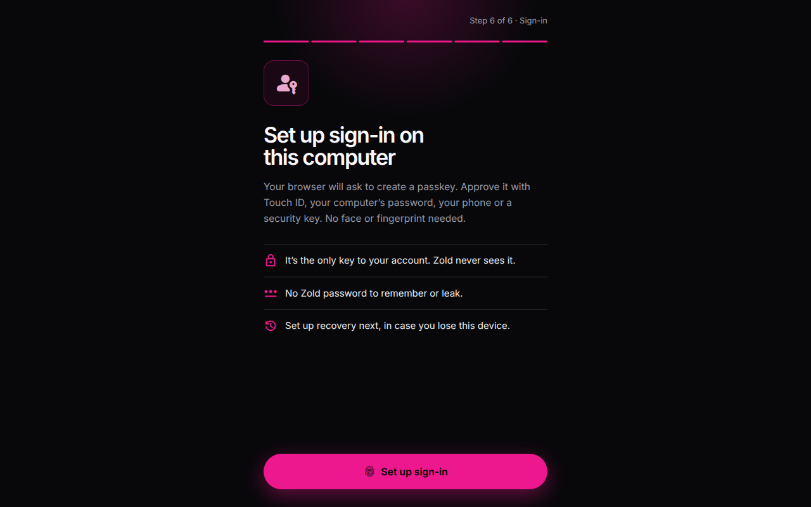

# Security and recovery

Your passkey approves transfers. Recovery can move your account to a new device, but never sends money.

## Your two keys

**Passkey:** Face ID, fingerprint, device PIN or computer sign-in unlocks the key in your device's secure hardware. Zold asks for that check at sign-in and for each transfer; a security key without a PIN or fingerprint cannot be used.

**Payment key:** Each browser creates one the first time you use your account there. It signs the amount, payee and transfer. Where supported, it is encrypted with a secret only your Face ID or fingerprint can unlock.

Settings → **Security** shows whether this device's payment key is encrypted. **Not encrypted** means it is stored in that browser as-is. A copy cannot move money without your passkey, but could sign payment terms. Do not use Zold in a shared browser; remove extensions you do not trust.

Zold cannot move your money or replace your passkey. A new passkey needs approval by the current one. Zold pays network fees. If you choose Zoldenburg recovery, it can start a device move after checking your identity; it cannot send money or skip the wait, and your current device can cancel it.

If you skip recovery, Home shows **Recovery isn't set up** with a setup link. You can close the message; Security continues to show recovery is off.

## Choose Zoldenburg recovery

When you open your account, Zold asks whether Zoldenburg may recover it. Change your answer any time: Profile → **Recovery** → **Add Zoldenburg recovery**, then approve. Adding it can take up to a minute. Recovery works only for accounts whose identity Monerium verified.

### Confirm your bank account

Send at least **€1** from a bank account in your own name to your Zold IBAN. It reaches your balance; nothing is charged. This proves which bank account is yours.

1. On **Recovery**, choose **Confirm my bank account** and approve. Zold shows your IBAN, name and a one-time reference. If you lose it, request another.
2. Send at least €1 from your own bank account with that reference. A transfer from your Zold IBAN does not count.
3. Choose **I sent it — check now**, or wait for Zold to check. A bank transfer can take a working day. Zold confirms that the sender name matches Monerium's verified name.

Until confirmed, **Security** shows **1 step left**. If your IBAN is not active, Recovery shows **2 steps left** and **Get my Zold IBAN**.

Recovery shows the confirmed bank account's last four characters. Keep it open: recovery needs another €1 from that same account. If your bank changes, choose **Changed banks? Use another account**; the old one stays until the new one is confirmed. Zold stores a fingerprint and the last four characters, not the full IBAN or payer name. Removing Zoldenburg recovery deletes them.

### Recover a lost device

1. On the sign-in screen choose **Recover your account**, enter your account email and set up a passkey on the new device.
2. Choose **Show my transfer details**. Send at least €1 from the same confirmed bank account to your Zold IBAN with the displayed reference. Another account or a different name does not count. If you lose the reference, get a new one; a payment sent with an earlier reference still counts.
3. Choose **I sent it — check now** or leave the page open; Zold checks every few minutes. Only send this if you started recovery. Zoldenburg will never ask you to send it.
4. Email support@zoldhq.com from the address on your account with the reference. Zold checks you against Monerium's verified identity. Zoldenburg cannot sign until the €1 arrives.
5. After Zoldenburg signs, a **3-day** waiting period begins. Your old device remains in control. While Zold is open on a signed-in device, it shows a warning on every screen from the request; Zold emails you when recovery is requested and when the wait starts, with its end date. If you did not request it, choose **Review** and cancel with your passkey.
6. When the wait ends, the new device is the only approver. Old sessions end, its payment key is unbound, and any backup key is removed.


Without recovery, Zoldenburg UG cannot recover a lost account or device. Only your euro balance can be reclaimed from Monerium under Icelandic e-money law; other assets cannot be recovered.


Recovery emails contain no link and never ask for approval or a code. Open Zold yourself to cancel. **It was me** hides the warning on that device until you close the tab. The wait protects you because Zoldenburg can start a recovery without your old device.

## Email or SMS recovery


**Not yet fully live.** Email and SMS recovery are not offered yet.


When available, register an email, phone or both at Profile → **Recovery**. Confirm every channel with a one-time code and approve with your passkey; contacts are masked.

To recover: enter your recovery email on the sign-in screen, set up a passkey, and confirm a code on **every** registered channel. A waiting period follows. Your old device remains in control and can cancel with your passkey from the warning shown while Zold is open. When it ends, the new device becomes the approver; old sessions end and its payment key is unbound.

## Google or Apple login


**Not yet fully live.** Google or Apple recovery isn't offered yet. The steps below describe how it will work.


Set it up when creating your account or later from Profile → **Recovery**. Use one recovery helper at a time; if Zoldenburg or email recovery is on, remove it first.

The login's own key is held by Turnkey for you alone. Zold never holds it; it signs only a move to a new phone, never a payment. The move waits first, and the phone you still have can cancel it.

**To recover:** On the new phone, choose **Recover your account**, create a new key, and approve with the same Google or Apple login.

Pick a login with a different email from your Zold account, and turn on two-step sign-in.

## Your own backup key

Add a key you keep, such as a hardware wallet, under Settings → **Who approves payments**. Zold never asks for or uses it. It can approve on its own, so protect it like the money it can move; with it, you can reach the account without Zold. See [How Zold works under the hood](../reference/how-it-works.md#your-own-backup-key).

## Sessions

A session ends when you sign out or it expires. Signing in on a new device does not sign out other devices. Registering a new passkey, or replacing or removing Monerium, signs out every other device and requires your passkey. If a device may be compromised, start recovery; completion revokes its sessions.
