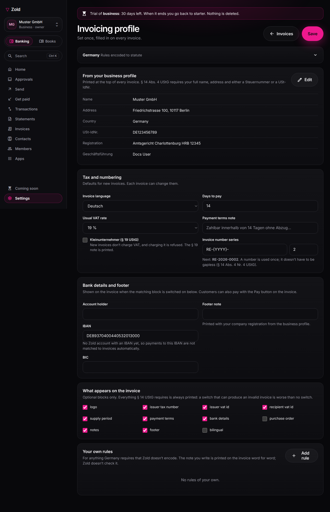

# Invoice settings

Who you are is entered once, in your **business profile**, and every invoice reads it from there. How your invoices are made (language, VAT defaults, numbering, bank details) is set in the **invoicing profile**. Both are under **Settings** in the business dashboard.

## Business profile

**Settings → Business profile.** The one place your company's details are kept. The invoicing profile shows them read-only, with an **Edit** link back here.

| Field | Notes |
| --- | --- |
| Name | The trading name shown in the app. |
| Legal name | Printed on invoices in place of the trading name, since the legal entity is what the tax office matches. |
| Registered address | Street, postcode, city and country. The country decides which invoicing rules apply, and the field names below follow it. |
| VAT ID | Your VAT, GST or sales tax number. In the EU it is checked against your member state's format; elsewhere it is printed as you write it. |
| Tax number | Your national tax number (in Germany, the Steuernummer). Most countries require this or the VAT ID on every invoice. |
| Company register, registration number | Where the law requires them on business letters (in Germany, Amtsgericht and HRB number). Printed in the invoice footer. |
| Managing director | Printed with the registration details. |
| Notification email | Where Zold writes to you. |
| Reporting currency | For the books; not printed. |
| Reporting time zone | The zone your monthly reports run in. It starts as your browser's zone; change it if your books follow another. |

## Invoicing profile

**Settings → Invoicing profile.**

| Field | Notes |
| --- | --- |
| Invoice language | English, German, French or Spanish — the language new invoices are written in. Until you pick one it follows your country (German for Germany, Austria, Switzerland and Liechtenstein; French for France; Spanish for Spain; English elsewhere). |
| Small-business scheme | Tick it if § 19 UStG (or your country's equivalent) applies. Invoices are then issued exempt and the "Charge VAT" option is off until you untick it. |
| Default VAT rate | The rate new lines start with. Germany is fixed at 19% or 7%; elsewhere you set it. |
| Payment terms | Days, plus the note printed on the invoice, e.g. "Payable within 14 days without deduction". |
| Invoice number series | A prefix (`{YYYY}` inserts the year) and the next number. It starts as `INV-{YYYY}-`, or `RE-{YYYY}-` for a German-speaking company. The next number to be issued is shown. |

## Bank details and footer

| Field | Notes |
| --- | --- |
| Account holder, IBAN, BIC | Printed in the bank block. Leave the IBAN empty and invoices print your Zold account's IBAN; the field shows which one. Payments to that IBAN mark invoices paid. If you enter another IBAN, the field is tagged **Not matched**: Zold doesn't see payments to it, so you mark those invoices paid by hand. |
| Footer note | Free text at the bottom of every invoice, printed with your registration details from the business profile. |

## Display defaults

The **What appears on the invoice** toggles have organisation-wide defaults here and can be changed per invoice. They cover optional blocks only. Everything your rule set requires is printed unconditionally and is not a toggle.

## On the invoice form

When you issue an invoice, the preview shows your name, address, VAT ID and tax number as they will print. If your address or a tax number is missing, the form says so and links to your business profile. Nothing on the issuer side is retyped per document.

## Snapshot on issue

Each issued invoice stores a copy of these details as they were at the moment of issue. Changing them here affects future invoices only.
