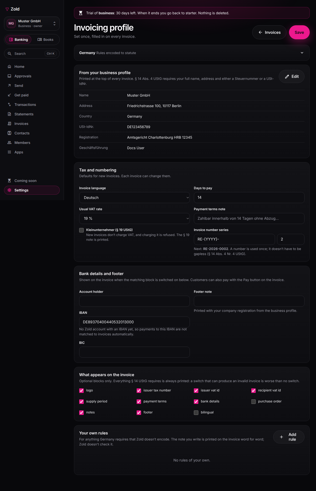

# Invoice settings

Set your identity in **Settings → Business profile** and invoice defaults in **Settings → Invoicing profile**. New invoices use both.

## Business profile

| Field | Used for |
| --- | --- |
| Name, legal name | Legal name prints on invoices. |
| Legal form | Company or sole trader, chosen when you create the business. Until the euro account is set up, an owner can choose **Change legal form**; then it is fixed. |
| Registered address | Invoice identity and country rules. |
| VAT ID, tax number | Most countries require one on invoices. EU VAT IDs are checked against the member state's format and must start with your own country's code (EL for Greece). Changing country re-checks them. |
| Company register, number, managing director | Printed; in Germany, Amtsgericht and HRB number. |
| Email on your invoices | Optional; saved with each new invoice as your contact address. |
| Notification email | Zold messages. |
| Reporting currency, time zone | Books and monthly reports; not printed. The time zone also sets the day: a new invoice is dated today there, and statement lines are booked on its days. It starts as your browser's. |

The Invoicing profile shows these read-only; choose **Edit** to change them.

Until you save a VAT ID or tax number, the tax ID from signup prints, if it passes the same check. Saving the fields, even empty, replaces it.

## Invoicing profile

| Setting | Default |
| --- | --- |
| Language | English, German, French or Spanish. Until selected: German for Germany, Austria, Switzerland and Liechtenstein; French for France; Spanish for Spain; English elsewhere. |
| Small-business scheme | Select if §19 UStG or your country's equivalent applies. Invoices are exempt until you turn it off. |
| VAT rate | Default for new lines. Germany uses 19% or 7%; elsewhere you set it. |
| Payment terms | Due days and printed note, such as “Payable within 14 days without deduction”. |
| Invoice number series | Prefix and next number. `{YYYY}` inserts the invoice date's year; default `INV-{YYYY}-`, or `RE-{YYYY}-` for German-speaking companies. A number already used, such as one you typed on an invoice yourself, is skipped. |

## Logo

Your logo prints top right on new invoices. In **Settings → Invoicing profile → Logo**, choose **Upload logo** and pick a PNG, JPEG or WebP file. Zold scales it to at most 800 × 230 pixels and 40 kB; a very detailed image that stays over 40 kB is refused, so use a simpler version of the logo. SVG files are not accepted.

**Replace logo** and **Remove** change only invoices you issue from then on. Each issued invoice keeps the logo it was issued with.

## Bank details and display

- Set account holder, IBAN and BIC for the bank block.
- Leave IBAN empty to print your Zold IBAN; payments there mark invoices paid.
- A different IBAN is marked **Not matched**. Zold cannot see its payments; mark those invoices paid by hand.
- A free-text footer note prints with your registration details.
- **What appears on the invoice** toggles optional blocks, per invoice if needed. Legally required fields always print.
- Issued invoices keep a snapshot; later profile changes affect future invoices only.
