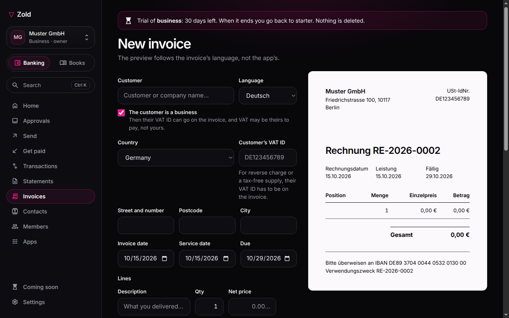
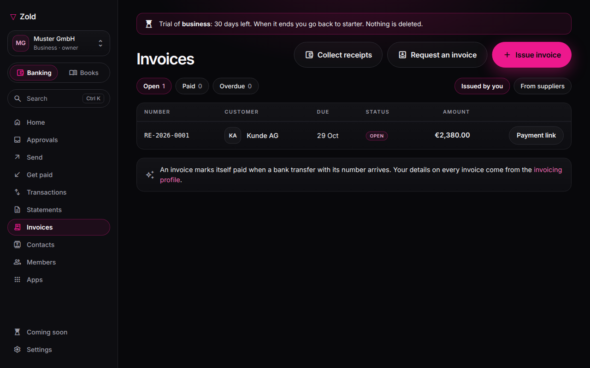
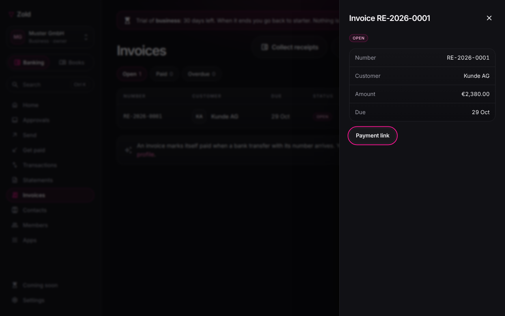

# Issue an invoice

Write an invoice in Zold and send your customer one link with a **Pay** button.

Fill in your [business profile and invoicing profile](invoice-settings.md) once; every invoice is prefilled from them.

No personal space yet? In the app, press **Get paid → Invoice**, fill in the name and country for your invoices, and Zold Business opens on **Invoices**.

## Steps

1. Go to **Invoices → Issue an invoice**.
2. Pick a **customer** from your contacts, or type their name and address. Reverse-charge or intra-community needs their VAT ID.
3. Set the **invoice date** and the **date of supply**. A German invoice needs the date of supply even when it's the same day.
4. Add **lines**: description, quantity, unit price, VAT rate.
5. Set **VAT**: taxable, or **exempt** with a reason from the list. Exempt means no line carries VAT.
6. Wait for **Ready to issue**.
7. Press **Create and share** and copy the link. It is shown once.

Your customer opens the link and pays by bank transfer or USDC. The invoice is marked paid when the money arrives.

## Good to know

- **Language**: English, German, French or Spanish; default from your invoicing profile, changeable per invoice.
- **Number**: from your series; you can override it, but it must be unique.
- **Due date**: from your payment terms; changeable per invoice.
- **Errors block, warnings don't.** The panel names the rule behind each item and what Zold doesn't check for your country.
- **What appears on the invoice**: optional blocks only. Anything the law requires always prints.
- **Issued means frozen.** Later profile changes don't touch it.

## Another currency

A new invoice starts in your country's currency where Zold knows it (India: INR), otherwise EUR. Any currency with a published rate works. The invoice prints the euro amount at the issue-day rate, and its Pay link is for that euro amount.

## Outside Germany

Only Germany's invoicing rules are built in. Elsewhere the panel says your country's tax rules aren't checked: Zold checks your name, your address, a unique number and that your tax reason exists there, then asks you to check the rest yourself.


Zold is not a tax adviser. For a German issuer it won't produce an invoice missing a mandatory § 14 field, or show VAT you said you don't owe. Whether a supply is exempt is your call, with your accountant.


## See an issued invoice again

1. Go to **Invoices** and click the invoice's row.
2. Press **View, print or save as PDF**. The invoice opens as your customer sees it.
3. Press **Print / PDF** and pick **Save as PDF** to keep a copy.

The issued invoice stays read-only. It opens in a browser where you're signed in to Zold Business.

## No Pay button?

The Pay button pays into your organisation's euro account, and only the member who connected that account can create it. In your personal space it pays into your own wallet, with or without an IBAN.

If someone else issues the invoice, the account isn't open yet, or no way to get paid is set up, the invoice goes out without the button, showing your bank details if you have an IBAN. Claim your payment page under **Profile → Payment page**, then add the button with **Payment link** in the invoice list. One invoice has one payment link.

Without an IBAN, the payment page shows your wallet address, its QR code, the network and the tokens it accepts. No bank details appear.

The link stays open until 60 days after the due date: at least 30 days, at most a year. Once it expires, the invoice page tells your customer and points them to your bank details or to you for a new link.

## Simplified invoices (Germany only)

Up to **€250 gross**, a German invoice may leave out the recipient, number, tax number and date of supply.


**Not yet live.** An issued invoice can't be edited, deleted or cancelled. Cancellation invoices and credit notes are coming, so check before you press **Create and share**. E-invoices (XRechnung / ZUGFeRD) are coming too. German businesses must already be able to receive them, and issuing them phases in from 2027.

