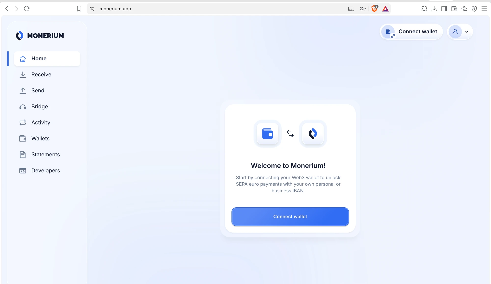
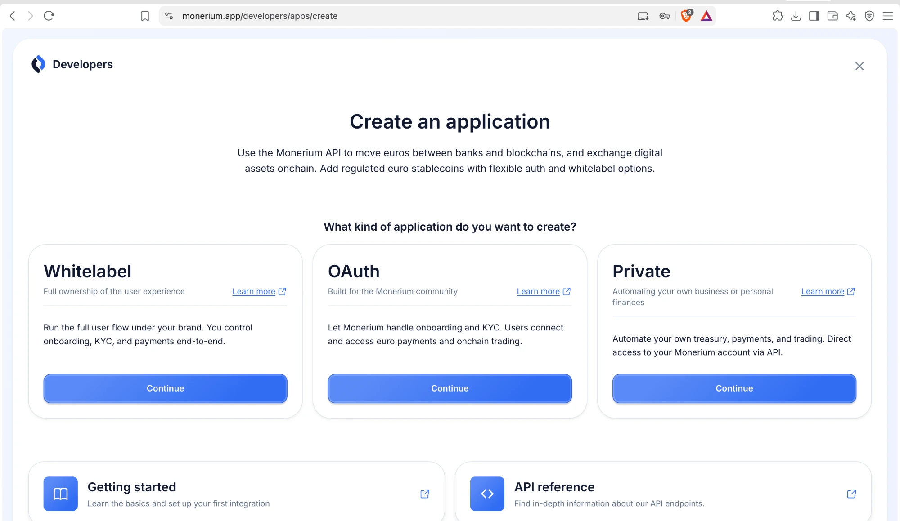
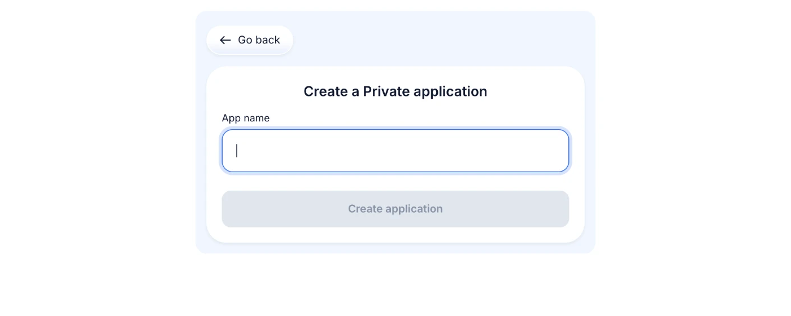
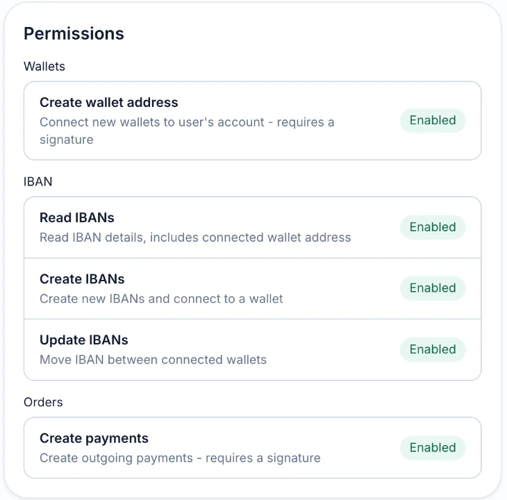

# Test Zold on mainnet

app.zoldhq.com runs Zold on Base mainnet with Monerium production. Real euros move. Sign-in with Monerium is off there, so you connect your own Monerium API keys.


This is real money. Test with small amounts, such as 1 €. You are among the first users: no SEPA payout has left a mainnet account yet.


## Get access

app.zoldhq.com sits behind Cloudflare Access. Write to **aurel@zoldhq.com** with the email you want to sign in with. Once you are added, Cloudflare sends you a code each time you open the app.

## Get your Monerium API keys

You need a verified Monerium account at monerium.app.

1. Sign in at **monerium.app** and open **Developers** in the side menu.
2. Under **What kind of application do you want to create?**, press **Continue** on **Private**.

3. Enter an **App name**, for example "Zold", and press **Create application**.

4. Copy the **CLIENT ID** and the **CLIENT SECRET**. The secret is shown only once; keep it somewhere safe.
5. Check that the status reads **Live** and the permissions below are **Enabled**.

## Connect the keys in Zold

1. Open **app.zoldhq.com**, create your account and set up your passkey.
2. At the IBAN step, choose **Add Monerium API keys**.
3. Paste the client ID and secret. Zold checks the pair with Monerium before it stores it.
4. Press **Get your IBAN** and approve with your passkey.

Then work through the [tester checklist](tester-checklist.md).

## Privacy: what Zold reads from Monerium

A Private app can see your whole Monerium account. Zold uses the keys for this, and nothing else:

| Zold reads | What for |
| --- | --- |
| Your Monerium login email | Stored with the keys, to show which account is connected |
| Your profiles: id, name, kind, state | Picks the profile that matches your Zold account (personal or company) |
| Your IBANs and the wallet addresses linked to them | Finds the IBAN linked to your Zold wallet. This list is stored with the connection |
| Your Monerium orders (bank payments in and out) | Credits deposits to your Zold wallet and builds your statement |

- **Only your Zold wallet** shows in the app. Zold shows no balance or activity of your other wallets linked to Monerium.
- **Other wallets stay yours**: every Monerium payment needs a signature from the paying wallet. Zold only gets passkey signatures, for your Zold wallet.
- **No home address, birth date or ID document** is stored. Of a profile, Zold keeps id, name, kind and state.
- **Your secret is encrypted** at rest and never shown again.
- **Removing the keys** in Zold deletes the stored email, profile and address lists. Deposits and payouts pause.

## Good to know

- **One IBAN per profile**: if your Monerium IBAN already pays into another wallet, Zold offers to move it. Your old wallet then stops receiving.
- **Personal vs company**: a personal Zold account uses your personal Monerium profile, a business account your company profile.
- **When you are done**: remove the keys in Zold, then delete the app under **Developers** at Monerium.
- **Something broke?** Write to aurel@zoldhq.com with the time, what you pressed and a screenshot. Never send your client secret.
